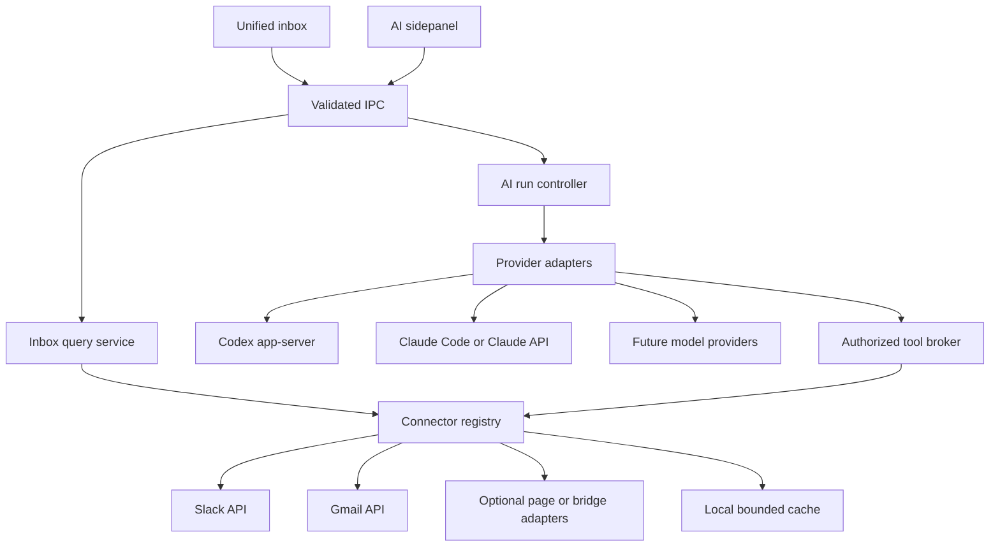

# AI search and unified inbox implementation plan

Research checked 18 October 2026. **Approved for implementation in two phases: unified inbox first, then AI search.** Git consolidation is tracked at the end of this document.

Hangar can support both a unified inbox and an AI sidepanel that searches connected apps. Build them on one connector layer: the inbox lists conversations, while the assistant searches and retrieves evidence through the same account permissions. Keep AI providers interchangeable. A web app being signed in inside Hangar does **not** automatically grant a supported API integration, complete message history, or access to the user's existing ChatGPT/Claude connectors.

**Recommended first release:** grouped, read-only Slack and Gmail conversations; source-linked previews; a Codex-powered search sidepanel; optional local Claude Code support after its login/tool-permission spike. Existing page probes can supplement other apps with clearly labelled unread summaries. Full personal Messenger history and sending replies are separate scope decisions.

## Scope to keep or cut

| Item | Recommendation | What it delivers or costs |
| --- | --- | --- |
| Shared connector registry and account permissions | Keep | Both features use the same source identities, capabilities and credentials |
| Unified inbox with categories and app/account filters | Keep | One place to scan conversations; preserves work/personal boundaries |
| Slack and Gmail API search and reading | Keep | Reliable initial sources for messages, threads and citations |
| Codex login and streaming sidepanel | Keep | First real provider, with explicit source selection and cancellation |
| Claude Code local runtime adapter | Next, or include if both providers are essential at launch | Uses the unmodified binary and its own authentication; adds process and permission testing |
| Claude API adapter | Optional | Straightforward controlled tool loop; separate API authentication/billing |
| Unread summaries from Messenger, WhatsApp and Teams pages | Experimental | Partial currently rendered lists; no claim of complete history |
| Personal Messenger full-history integration | Defer behind a feasibility gate | Needs a maintained, permitted bridge or a validated limited browser workflow |
| Local save, snooze and custom views | Next | Useful triage without writing to source apps |
| Source mark-read/archive actions | Later | Per-provider write permission and clear source/local semantics |
| Replies and AI drafts with send confirmation | Later | Adds recipient, identity, threading, attachment and duplicate-send risks |
| Continuous AI classification and proactive summaries | Defer | Recurring cost, data disclosure and background work; deterministic categories work first |
| Full historical import, semantic index and cross-device sync | Defer | Storage, retention, deletion propagation and expensive backfill |

Cutting the experimental connectors and second AI provider gives the smallest useful release. Cutting the shared connector/permission layer makes both features harder to extend later.

## What the repository already provides

- Electron `BaseWindow` with separate `WebContentsView` processes and persistent account partitions. [Architecture](architecture.md) describes why a CSS drawer in the rail cannot simply cover native service panes.
- A React shell, typed `Command` dispatch, validated IPC, pull-then-subscribe state, theme tokens, keyboard rebinding, overlays and focus management.
- A control socket with a narrow command allowlist, plus meeting and conversation probes. `ConversationBridge` currently reads **unread names/counts**, not message bodies: at most 80 rendered rows and 30 reported conversations. Slack/WhatsApp have fixture coverage; Teams/Messenger selectors still need validation on real pages.
- Account identity, workspaces, unread evidence, hibernation and explicit boundaries between `core`, `main`, `preload`, `renderer` and `shared`.

Missing pieces are provider runtimes, credential storage for APIs, message/search connectors, an inbox data store, result provenance and the two new UI surfaces. The existing notification history is useful evidence of recent activity, but cannot reconstruct an inbox or old messages. Keep message bodies and AI transcripts out of the broadly broadcast `ShellState` and existing control-socket state.

## AI login and provider choices

| Route | Supported approach | Recommendation |
| --- | --- | --- |
| Codex runtime | Start `codex app-server` as a supervised local process; use its JSON-RPC login, thread, turn, streaming and cancellation interfaces | First adapter; generate protocol types from the pinned installed version |
| Sign in with ChatGPT for Hangar | Current official documentation supports an open-source/local app requesting eligible ChatGPT-plan inference permission through its own OAuth registration | Evaluate as a second auth mode; keep credentials owned by Hangar separate from Codex's managed login |
| Local Claude Code | Run the unmodified CLI; the end user completes Anthropic's own login. Consume structured streaming output and provide explicit MCP tools | Viable local-runtime route, conditional on the controls proved in the spike |
| Custom Claude agent | Claude API/Agent SDK with supported API or cloud credentials | Separate adapter/auth mode; do not extract Claude subscription tokens |
| Future providers | Implement the engine contract with capability discovery | No connector or inbox rewrite |

Codex app-server exposes account login, threads, streamed turns and rate-limit information. Use its managed browser login for the first spike; do not assume a successful login guarantees access to every model returned by a catalog. [OpenAI app-server documentation](https://learn.chatgpt.com/docs/app-server).

OpenAI's separate Sign in with ChatGPT plan-usage flow supports open-source/local applications, with registration and a stable host identifier. It does not provide ChatGPT conversation context. Paid/remote products have a separate onboarding path. [Plan usage](https://developers.openai.com/siwc/token-sharing-open-source), [registration](https://developers.openai.com/siwc/token-sharing-open-source/sign-in).

If using that flow, its preview currently excludes hosted MCP/connectors and several hosted tools; Hangar must execute its own tools locally. The documented app-server configuration can use the resulting access token, with refresh managed by Hangar. Do not mix that lifecycle with app-server-managed credentials. [Preview limitations](https://developers.openai.com/siwc/token-sharing-open-source/preview-limitations), [app-server configuration](https://developers.openai.com/siwc/token-sharing-open-source/codex-app-server).

Anthropic distinguishes running its unmodified Claude Code binary, where users can authenticate themselves, from offering a third-party Claude.ai login or collecting/intermediating subscription credentials. The latter is not permitted under its documented rules. Preserve all built-in authentication choices and direct end-user billing in the local-runtime integration. [Claude Code integration and authentication conditions](https://code.claude.com/docs/en/legal-and-compliance).

The CLI supports programmatic streaming and resumable sessions; the Agent SDK offers a programmable agent loop and custom/MCP tools. The Phase 2 runtime checks must validate which interface fits Hangar's permitted authentication path and required tool restrictions. [Programmatic CLI](https://code.claude.com/docs/en/headless), [Agent SDK](https://code.claude.com/docs/en/agent-sdk/overview).

## Connected-app feasibility

| Source | AI search | Unified reading | Initial access and limitations |
| --- | --- | --- | --- |
| Slack | Yes, authorized user search | Channels/DMs/threads within granted access; incremental fetch | User OAuth, `search:read`; conversation scopes separately for enumeration/history. Workspace policy and retention apply |
| Gmail | Yes, Gmail query syntax | Thread previews and message bodies; incremental history | Desktop OAuth, `gmail.readonly`; public release requires restricted-scope review planning |
| Personal Messenger | No general personal-history route established by this research | Rendered unread rows may be possible; full-history bridge unproven | Keep experimental and honestly partial; Page/business API is a different product |
| Messenger business/Page | Potentially, over authorized Page conversations | Page/business conversations | Page token, relevant permissions and app review; separate connector |
| WhatsApp personal | Bounded visible-page assistance, after validation | Existing unread names/counts; full history not established | Do not treat Business APIs as access to a personal WhatsApp account |
| Teams/other apps | Add individually | Depends on API/scopes or validated page adapter | Capability-based rollout; a catalog entry alone is not a connector |

Slack's search endpoint requires a **user** token with `search:read`. Search results can link back to their original messages. [Slack search](https://docs.slack.dev/reference/methods/search.messages/).

There is now a documented Slack **public-client PKCE flow** for desktop apps, without embedding a client secret. It supports desktop redirects and user scopes, with rotating tokens and a finite refresh-token lifetime. This changes the old repo assumption that a backend secret necessarily blocks Slack integration. Start with this route; handle reauthorization and verify the returned workspace/account identity. [Slack PKCE](https://docs.slack.dev/authentication/using-pkce/).

History and thread retrieval have different rate limits from search, including tighter limits for some commercially distributed apps. Avoid polling every channel or promising instant complete backfill. Track per-method/workspace budgets and honor `Retry-After`. [Slack limits](https://docs.slack.dev/apis/web-api/rate-limits/).

Gmail supports `q` search, but message listing returns identifiers that need subsequent retrieval for content. `gmail.metadata` is insufficient for this full search/read experience. `gmail.readonly` is a restricted scope; public distribution and transferring restricted data to an AI provider require review against Google's applicable requirements. Desktop OAuth should use the system browser and PKCE. [Message listing](https://developers.google.com/workspace/gmail/api/reference/rest/v1/users.messages/list), [scopes](https://developers.google.com/workspace/gmail/api/auth/scopes), [desktop OAuth](https://developers.google.com/identity/protocols/oauth2/native-app).

For Gmail updates, store a history cursor and recover from an expired cursor through a bounded resync. Push notifications are change signals, not complete message bodies; a local-only first release can poll incrementally while active. [Gmail synchronization](https://developers.google.com/workspace/gmail/api/guides/sync).

Meta's published API collection describes conversations between people and a **Page/business**, not arbitrary personal inbox access. Its main developer pages returned access/rate-limit errors during this review; validate the personal-account route before committing to it. [Meta's Conversations API collection](https://www.postman.com/meta/messenger-platform-api/folder/22794852-255610cd-47f5-4f4d-b3fa-71aec360be9a). Beeper demonstrates that a unified personal-chat client can exist, but its product does not establish that Hangar has a reusable public API or the same integration rights. [Beeper](https://www.beeper.com/).

## Unified inbox experience

### Recommended layout

Keep Hangar's app rail. Add a distinct **Inbox** destination, not a replacement for the existing app panes. The inbox occupies the content area and uses a two-column list/detail layout, with a small navigation/filter region when space permits.

1. **Top bar:** workspace boundary, search, Unread/All toggle, source freshness, and Ask AI. Default to the current workspace; searching all workspaces is an explicit scope change.
2. **Grouped list:** Direct messages, Mentions, Email, Channel activity, and Other when type is unknown. Each row represents a conversation/thread, with sender, subject/channel, a short preview if available, app/account identity, timestamp and unread state.
3. **Reading pane:** the selected thread, source/account identity and Open in app. Preserve selection and scroll position as updates arrive. Browsing a preview does not silently mark the source read.
4. **AI sidepanel:** an optional right-hand surface with the current context chip, source controls, progress and cited answer. On narrower windows it replaces the reading pane temporarily; it must not squeeze four columns into an unreadable layout.

Categories and apps are separate dimensions: allow **Group by category** or **Group by app**, and app/account filters in either view. Give every row one primary category to avoid duplicate counts; a direct message that mentions you appears under Direct messages with a mention indicator. Saved views can overlap, but a single view deduplicates by source identity. Unknown classification stays Other.

Start with deterministic metadata categories. An optional future “Needs attention” view may combine mentions, DMs and pinned people; if AI adds priority, explain why, let the user correct it, and retain a chronological view. Do not label all unread items “needs reply.”

The design borrows specific patterns, not vendors' productivity claims: Slack's grouped unread browsing, filters and reversible triage; Superhuman's saved splits for batching work; Beeper's persistent source identity in a unified chat product. [Slack Unreads](https://slack.com/help/articles/226410907-View-all-your-unread-messages), [Superhuman Split Inbox](https://blog.superhuman.com/how-product-teams-can-organize-their-inbox/), [Beeper](https://www.beeper.com/). These support the proposed interaction patterns; the best arrangement for Hangar still needs user testing.

### States and interaction details

- Distinguish **Live**, **Updated 5 minutes ago**, **Sleeping**, **Reconnect**, **Limited preview**, **Unavailable**, and **No results**. Missing access is not an empty inbox. A partial DOM list must not appear complete.
- Counts label what they count: unread conversations in Inbox, not a sum of incompatible message/channel/notification badges. Preserve exact/estimated/unknown count confidence.
- Show a “New activity” affordance instead of moving the selected row while someone reads. Keep muted channels collapsed/filtered according to the user's view settings.
- Local Save/Snooze/Dismiss is separate from source Read/Archive. Explain the distinction at the action, and provide Undo for reversible local triage.
- Opening in the original app may trigger that app's own read receipt. Say so for integrations where it matters. The assistant's read tools should prefer APIs that do not mutate read state.
- Full keyboard operation, visible focus, labelled controls, screen-reader announcements for results/errors, reduced-motion support, and readable light/dark themes. Reuse Hangar's rebinding system; avoid stealing service shortcuts.
- At compact widths, show list then detail with Back. A docked AI panel needs minimum width, resize persistence and focus return to its invoking control. Escape closes the topmost surface first.

### Alternatives considered

| Design | Strength | Tradeoff | Decision |
| --- | --- | --- | --- |
| Existing live app panes/mosaic | Immediate native functionality using existing sessions | Different layouts and search per app; no normalized inbox | Keep as the existing workspace experience |
| Grouped conversation list plus reader | Fast scanning, clear categories, consistent keyboard flow | Needs normalized connectors and honest partial states | Recommended default |
| Separate column per app | Clear app separation | Horizontal space/scroll grows with every app; noisy on laptops | Optional experiment, not the default |
| A complete replacement messaging client | Deep read/reply functionality | Integration maintenance, history, attachments and send semantics | Longer-term product decision |

## AI sidepanel workflow

For “Give me all the information about this feature”:

1. Capture the user's selected conversation/page context only when opted in. Show the feature name and source/account scope. Ask for the feature name if the available context is ambiguous.
2. List **authorized connector capabilities**, not browser tabs or guessed endpoints. Infer relevant sources from feature keys, participants and available apps. Show a compact editable search plan, such as “Slack + Gmail · current workspace.”
3. Search sources concurrently within rate and time budgets; use aliases and exact feature keys. Fetch the most relevant threads for context, paginate within a visible limit, and follow a source link only if its connector/account is authorized.
4. Deduplicate by canonical source/account/thread/message IDs. Build evidence records with title, timestamp, author, source URI and retrieval time. Do not combine same-named people across accounts automatically.
5. Return overview, decisions, owners, dates, unresolved questions and conflicting evidence with clickable citations. Separate facts from inference and make scope gaps explicit: “Searched Slack and Gmail; Messenger history unavailable.” Never claim exhaustive coverage solely because the prompt says “all.”
6. Stream progress, show partial results when one source fails, support Cancel, and allow a narrower follow-up. Offer a separate Continue searching action when the budget is exhausted.

No inbox item, email or retrieved document can grant tool permissions or change instructions. Treat retrieved text as untrusted evidence. The first release exposes only read tools plus explicit UI navigation; it has no message-send tool.

## Shared implementation architecture



**One connector implementation, two consumers.** Put source/auth/network adapters in `src/main/connectors/`; pure normalization, grouping, dedupe and policy in `src/core/inbox/` and `src/core/ai/`; shared DTOs in `src/shared/`. Add `src/main/ai/` for process supervision and provider SDKs. The renderer never imports those modules.

Suggested contracts (design, not final code):

```ts
interface Connector {
  id: string;
  capabilities(account: AccountRef): ConnectorCapabilities;
  listConversations(query: InboxQuery, ctx: AuthorizedContext): Promise<Page<ConversationSummary>>;
  search(query: SearchQuery, ctx: AuthorizedContext): Promise<Page<SearchHit>>;
  readThread(ref: SourceRef, ctx: AuthorizedContext): Promise<ThreadContent>;
  // Incremental changes and source navigation are optional capabilities.
}

interface AgentEngine {
  capabilities(): EngineCapabilities;
  authStatus(): Promise<AuthStatus>;
  start(request: AgentRequest, broker: ToolBroker): AsyncIterable<AgentEvent>;
  cancel(runId: string): Promise<void>;
  dispose(): Promise<void>;
}
```

Use a discriminated capability model so unsupported connector methods are impossible to call, rather than requiring fake methods. `AuthorizedContext` is constructed in main and carries a validated account allowlist, cancellation and budgets; the model cannot mint it. Source references are opaque handles resolved by the broker, not arbitrary fetch URLs.

The Codex/Claude Code adapters own their provider's agent loop. A direct model-API adapter owns its tool-call loop. Both emit the same Hangar events: status, text delta, tool start/result, source, permission request, usage, error and completion. Do not add a second planner loop around an already-agentic runtime.

Expose selected connector tools through a local, per-run **MCP facade** for CLI runtimes; direct API adapters may call the same broker in-process. MCP standardizes tool discovery/calls, not provider login, permission equivalence or complete inbox synchronization. Do not expose Hangar's whole control socket as an AI tool. [MCP tools](https://modelcontextprotocol.io/specification/2025-11-25/server/tools).

### Local data and UI boundaries

- Namespace all records by connector, remote tenant/account, conversation and message ID. Persist immutable source IDs, not display names. Preserve edits/deletions, pagination cursor, last successful sync and permission state.
- Start with bounded recent conversation summaries and short-lived retrieved bodies. Add SQLite/FTS only when persistence/query needs justify it, after checking the packaged Electron runtime or choosing a maintained driver. A full vector store is unnecessary for the initial federated-search feature.
- Store secrets through OS-protected storage in main. Keep them, content, indexes and transcripts out of config Git sync, exports, logs, renderer state and the control socket. Disconnect cancels in-flight operations and offers deletion of cached account content and derived answers.
- Use dedicated `inbox:get-page`/change events and `ai:start`/event/cancel IPC with sender checks, validated sizes and run IDs. Pull state when a surface mounts, then subscribe; discard stale responses after account/run changes.
- Build a dedicated `#inbox` surface and an `AiPanel` WebContentsView. Reuse Overlay's lifecycle conventions but give the AI panel its own bounds: reserve/reflow content when docked, detach on close, respect z-order, restore keyboard focus and destroy it on window disposal.
- Keep runtime processes separate from renderer/main blocking work. Pin/probe CLI versions; supervise startup, logout, expiry, cancellation and crashes. Use dedicated runtime profiles and explicitly configured tools. Disable default shell/file/write tools and inherited plugins/hooks for the search mode where supported; failure to enforce this blocks that adapter's release.
- Consent to sending retrieved content to the selected AI provider is separate from adding an app pane. Bind it to provider, accounts and workspace. Display the active provider, and never silently fail over to another provider with private content.

## Implementation sequence and acceptance gates

The user approved execution on 18 October 2026, with **two total phases**, in this order. Optional expansion remains outside this release.

| Phase | Scope | Exit condition |
| --- | --- | --- |
| **1. Unified inbox** | Shared connector identities, OS-protected credentials, Slack/Gmail browser OAuth and read APIs, grouped inbox, filters, thread reader, original-source navigation, limited page previews and native Electron lifecycle | Contract/security tests, read-only scopes, cancellation/revocation, stale/limited/error states, real Electron layout and accessibility, full regression suite |
| **2. AI search** | Provider contract, isolated Codex runtime and login, compatible Claude runtime adapter, authorized connector tools, sidepanel, source selection, streaming, cancellation, bounded search, citations and follow-ups | Runtime capability probes, fake-provider contract tests, tool/account restrictions, valid source references, native panel lifecycle and regression checks |

Phase 1 uses bounded in-memory snapshots and refresh while the inbox is open. Closing Hangar clears message content; credentials remain OS-encrypted outside config sync. This deliberately avoids a persistent message index and deletion backlog. Gmail history-cursor sync and a larger historical cache can follow after live account trials. Slack search has no unread flag, so those rows explicitly report unknown read state and are excluded from Unread only.

Public OAuth app registration, provider verification and a real-account trial are deployment dependencies, not simulated by fixture tests. The app accepts the user's registered public/desktop client configuration and uses the provider's browser consent flow. This repository does not contain production OAuth registration credentials.

The original 4–7 engineering-week range was a planning estimate, not a delivery commitment. Implementation status and validation evidence are recorded in the phase commits and PRs.

### Tests and success measures

- Connector contract fixtures: multiple accounts, pagination, duplicate deliveries, revoked access, rate limits, malformed data, thread edits/deletions and expired sync cursors. Live tests use explicitly selected test accounts and redact content.
- Provider contract tests: missing CLI, incompatible version, login cancel/expiry, incremental output, tool denial, interruption and process exit. No paid model calls in ordinary CI; opt-in integration checks use bounded budgets.
- Search evaluation set: about 20 realistic feature questions with known source evidence, including ambiguous feature names, conflicting dates, inaccessible apps and prompt injection. Target at least 90% supported answer claims and 100% valid source links in this test set before beta; measure recall separately from factual support.
- UX tasks: find an unread DM, locate a feature decision across Slack/email, change the account scope, distinguish partial coverage from no results, and open the original thread. Observe task completion and errors; do not infer usability from a visually polished mockup alone.
- Performance budgets to validate: cached inbox visible within 500 ms, local interaction feedback within 100 ms, first search progress within 1 second. Measure actual provider latency separately. Bound cached rows and render large lists through virtualization with accessible navigation.
- Regression checks: real Electron overlay focus, resize, multiple rail positions, window recreation, sleep/wake, active calls and offscreen throttling. The inbox must not defeat the performance work by keeping every service awake.

## Decisions to make after reviewing the plan

The recommended defaults above allow development to start without deciding every future feature. Before release, settle personal-only versus public distribution, whether a small backend is acceptable for providers that require one, the first two AI runtimes, local retention, and whether full personal Messenger support is a launch requirement. If Messenger is mandatory, complete its feasibility spike before promising the launch scope.

Replies, automatic categorization, cloud sync and proactive AI are deliberately separable. They can be added or cut without changing the connector and engine contracts.

## Git reconciliation and review

The initial checkout was clean on `perf/throttle-offscreen-services`; `main` and `origin/main` were at `49d9ba8`. The complete reachable history contained 168 commits at the initial inspection. Fetching refreshed the current remote branches. The second worktree, `hangar-next`, was clean on `fix/sso-redirects`; it remains intact.

The reconciliation branch preserves the original commits through merges:

| Work | Original tip | Disposition |
| --- | --- | --- |
| Conversation readout | `0044b2e` | Included |
| Sign-in redirects | `d7d43c1` | Included; retains both sign-in commits |
| Offscreen throttling | `41d55c4` | Included |
| GitHub Actions updates, PR 25 | `9f275e6` | Included |
| Runtime dependency updates, PR 28 | `dc06293` | Included |
| Development dependency updates, PR 29 | `ee7cdd7` | Included |

Older feature/dependency branches are already ancestors of main. Two obsolete Dependabot remote refs disappeared during fetch and were replaced by the current update branch. There were no active stashes. An object-integrity check reported unreachable historical objects, including old stash/WIP, simulated merges and superseded dependency commits; these were left intact rather than reviving abandoned work or garbage-collecting it.

Merge conflicts were limited to an import and appended decision records: conversations stays decision 119, sign-in becomes 120, and its references were updated. Additional checks cover offscreen throttling and the conversation bridge operating on a throttled service. Compatible dependency audit fixes are included. Local validation passed 1,139 tests, typechecking, lint and module boundaries. The last complete Electron run passed 91 of 92 scenarios; its fullscreen failure passed on isolated rerun. An earlier keyboard-focus failure also passed on rerun. CI remains the merge gate. Runtime audit is clean; eight moderate advisories remain in the build-tool chain, whose proposed forced fix would downgrade electron-builder. Renderer bundle sizes are within budget. Final CI/merge status is recorded in the PR and completion report.

Repository review also found stale README claims about API secrets and required code-owner approval. The README now reflects supported public-client OAuth and the observed protected-main policy. Historical decisions remain historical; this plan supplies the current implementation path.
