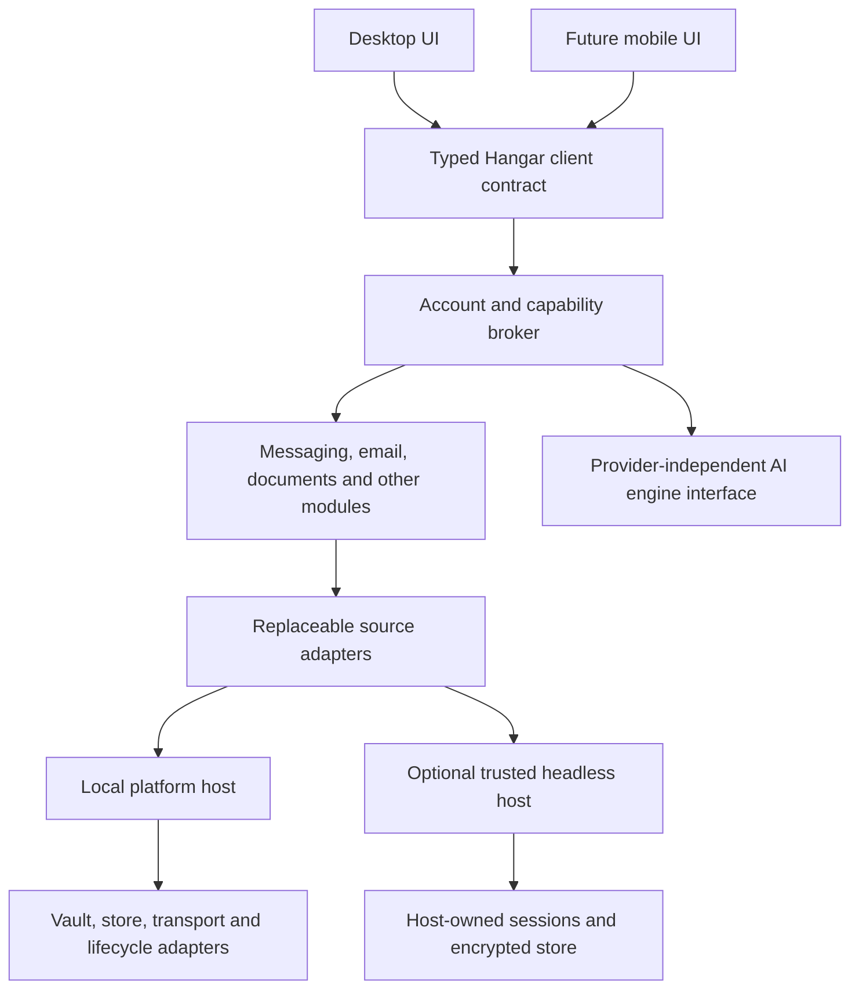

# Unified DM chat redesign

Review and implementation plan, 18 October 2026. This revises the inbox direction in the [combined plan](ai-and-unified-inbox-plan.md). The overall programme still has two phases: readable unified chat first, then AI search using those connections. Execution has started; the portable broker, Slack DM reader and Chats interface are implemented in the working tree. The three-network release is not complete or installed. See the [execution status](#execution-status-and-remaining-gates).

Build **Chats**: one list of one-to-one and group conversations across apps, with a full message timeline, inline replies and a New conversation flow. Prioritise personal WhatsApp, Messenger and Slack. Each source conversation stays separate, with its app and account visible. Message access is the first delivery gate; names without bodies do not count as a working chat integration.

**Scope clarification, 18 October 2026:** group chats that are not channels, starting conversations and sending text inside Hangar are required in Phase 1. They are no longer optional follow-ups. The current installed pilot remains a read-only, one-to-one Slack implementation; WhatsApp and Messenger message adapters are not implemented. The user subsequently explicitly resumed app testing.

**Recommendation: invest in a Hangar-owned local messaging layer.** Use supported service APIs where available and isolated, replaceable protocol adapters for personal messaging. Own account setup, normalized messages, local storage and the UI. Reuse maintained protocol libraries rather than implementing encryption and network protocols from scratch. Beeper is design inspiration and an optional interoperability adapter, not a required app or the foundation. This is the best architectural fit for an independent Hangar; it requires more integration and maintenance work than a companion API.

**Architecture requirement:** messaging is the first consumer of a general connector framework. Email, documents, files, tasks, calendar events and future connector types must use the same account, permission, search, sync and platform infrastructure without pretending to be chats. Desktop and future iOS/Android clients share contracts and domain logic; platform execution, UI and credentials have explicit adapters. Mobile readiness is part of the two current phases, while a complete mobile product remains a future delivery scope.

## Review of the current installation

The screenshot confirms the inbox UI is running, but its footer reports **0 read connections**. The seven Slack rows are limited page observations. Signing into a website inside Hangar does not create the separate API connection needed by the current reader.

| Finding | Code evidence | Required change |
| --- | --- | --- |
| Slack channels appear among the results | [Catalog](../src/shared/catalog.ts) probes every sidebar row with a channel ID, including channels and DMs | Introduce verified conversation types and request DMs explicitly |
| Names appear without messages | [Conversation probe](../src/core/services/conversations.ts) collects unread names/counts, not bodies; [hub](../src/main/connectors/hub.ts) labels them mentions or other | Keep names-only sources in connection status, outside the readable chat list |
| Connecting Slack alone will not create a proper chat timeline | [Slack connector](../src/main/connectors/slack.ts) lists recent search matches and reads individual threads through `conversations.replies` | Enumerate DM conversations and load their history; retain search separately |
| Message records cannot represent a modern chat | [Shared types](../src/shared/inbox.ts) only hold message ID, author, time and text | Add participants, direction, pagination and explicit content capabilities |
| The layout resembles an email reader | [Inbox UI](../src/renderer/inbox/Inbox.tsx) spends space on categories, grouping, a large header and a separate preview | Replace its primary surface with a compact conversation list and timeline |

Reuse account isolation, encrypted credential storage, cancellation, source references, IPC validation, workspace scoping and the AI panel. The current code is useful infrastructure, but the screenshot does not meet the requested messaging experience.

## Proposed experience

Keep Hangar's existing app rail. Rename the destination **Chats** and retain its keyboard shortcut. Use two main columns: a roughly 300 px conversation list and a flexible timeline. On narrow windows, selecting a conversation opens the timeline with a Back control. Remove the permanent category sidebar and oversized page heading.

The default list contains verified one-to-one DMs and group chats, sorted by latest known activity, including read conversations. Show avatar or initials, person/group title, latest message preview, time, unread state when known, and an app/account label. Offer All chats, People and Groups filters, plus Unread and an app filter. Show participant names in group timelines. Classify groups from provider metadata; Slack channels, WhatsApp channels/community containers and unknown conversation types never enter it by inference from participant count alone. Preserve current-workspace scope, with an explicit all-workspaces choice.

Use WhatsApp green, Messenger blue and Slack's purple/multicolour identity in app badges, selection accents and a subtle outgoing bubble tint. Keep body text neutral and readable. Always pair colour with an app name or icon and account label. Do not merge two people or their conversations merely because their display names match across apps.

The timeline shows real incoming and outgoing messages, sender identity, dates, message times and a visible history boundary. Load older messages while preserving scroll position. New messages appear at the bottom only when the reader is already there; otherwise show a new-message control. Keep the selected conversation stable when the list reorders. Resolve Slack user references into display names where authorised.

Start with text, safe links, reply context and explicit attachment placeholders. Images, files and voice notes need separate media handling before they are described as supported. Do not render provider HTML in the privileged shell. Unknown read receipts or delivery states remain unknown.

Reading remains the first engineering milestone; the Phase 1 completion target includes an inline text composer and **New conversation**. Until a provider's send capability is verified, label it read-only and provide **Reply in WhatsApp/Messenger/Slack** as a temporary fallback. An app-switching reply flow does not satisfy the seamless-chat acceptance criteria. AI search never gains sending authority from the human composer's grant.

### Starting and continuing conversations

1. **New conversation** opens a searchable recipient picker. Resolve contacts through connected accounts, displaying app/account identity with every result. If a person is available on several apps, let the user choose the destination. Do not merge contacts by name.
2. Select one recipient or multiple recipients for a provider-supported group. All members of a new group belong to one provider account; cross-network bridging is separate work. Show the chosen app, account and recipients above the draft.
3. Type and send in the same timeline. Resolve an existing conversation or create a new one when the user sends; browsing recipients must not create remote groups. Provider restrictions and unavailable recipients are shown before sending where discoverable.
4. Keep drafts per account/conversation or recipient set. The user's Send action authorizes that message; no extra confirmation is needed for every ordinary message once the account is connected. Changing accounts must not carry a draft to a different recipient silently.
5. Show pending, sent and failed states based on provider acknowledgements. Persist an encrypted outbox, reconcile incoming echoes and use provider-supported idempotency where available. An uncertain send result must not trigger blind retries that duplicate messages. Delivery/read receipts appear only when supported.

Connection setup must expose Slack, WhatsApp and Messenger with truthful states: available to connect, needs setup, experimental or not yet implemented. WhatsApp's planned onboarding is linked-device pairing; Messenger needs its own validated account-login/session flow. Existing web-pane sign-in is not a completed message connection. Normal navigation, contact selection, reading and sending stay inside Chats for a connector to pass the seamless-chat gate.

Connection setup explains what the person can actually do: **Messages available**, **Connecting**, **Reconnect**, or **Open in app**. A source with no readable bodies does not inflate the conversation count. When no source can read messages, show a useful connection screen rather than a list of blank previews. A transient message-load error belongs in that conversation with Retry; it must not silently disappear.

The interactive concept at `docs/mockups/hangar-chat.html` uses fictional messages. It previews the proposed layout, app filtering and conversation selection; it is not evidence of live integration.

## How to obtain the messages

### Slack through its supported user API

**User onboarding must not require registering a Slack app.** Hangar's publisher registers its public PKCE app once, configures the read scopes and ships the public client ID. Users choose **Connect Slack**, sign in and consent; workspace admin approval may still apply. Developer client fields belong in optional advanced settings, not the normal flow. This also applies to future connectors: distinguish provider registration owned by Hangar from account authorization owned by the user. Hangar's registration was created in the publisher's personal workspace on 18 October 2026; see the live verification status below. [Slack PKCE setup](https://docs.slack.dev/authentication/using-pkce/).

The official Slack MCP server does not remove this requirement: clients still need a registered app; dynamic client registration is unsupported, and access is restricted to internal or Marketplace apps. Access through a partner is another product dependency, not a way to reuse that partner's credentials in Hangar. For the custom timeline, retain the direct API adapter. A strict zero-registration alternative is the existing signed-in Slack view, with source-native rendering; a private web-session adapter would need a separate compatibility/security investigation and must not be presented as a supported API shortcut. [Slack MCP requirements](https://docs.slack.dev/ai/slack-mcp-server).

Use `conversations.list` with `types=im,mpim` and cursor pagination. Require verified `is_im`/`is_mpim` metadata and exclude public/private channels. Add `mpim:read` alongside `im:read` and `users:read`; use group membership to display participants. Reauthorisation is needed when a grant lacks these scopes. The current pilot only enumerates `im` and explicitly excludes `mpim`. [Conversation enumeration](https://docs.slack.dev/reference/methods/conversations.list/), [user profiles](https://docs.slack.dev/reference/methods/users.list/).

Implement create/resume through `conversations.open` with user scopes `im:write` and `mpim:write`; send through `chat.postMessage` with user scope `chat:write`. Keep sends on the authenticated user's identity, with the destination verified against that account's conversation metadata. These are planned additions, not permissions currently granted to Hangar. [Open a DM/group DM](https://docs.slack.dev/reference/methods/conversations.open/), [send a message](https://docs.slack.dev/reference/methods/chat.postMessage/).

Load the selected DM with `conversations.history` and `im:history`; use `mpim:history` for group DMs and `conversations.replies` for a specific thread. This changes the unit of the list from a search hit to a conversation. Retention, membership and app approval still govern access. Rate limits differ by distribution: Slack documents 1 request/minute and 15-item history pages for affected commercial apps outside its Marketplace, while internal customer-built apps retain Tier 3 limits. Schedule requests and honour Retry-After; do not promise instant historical backfill. [History and rate limits](https://docs.slack.dev/reference/methods/conversations.history/).

Slack documents that latest-message data may be absent for third-party conversation requests. Roster membership alone cannot supply a latest-message preview or reliable activity order. The initial adapter preserves unknown values and reads history on selection; completing the list experience needs a measured, rate-budgeted summary/update strategy. Do not fan out one history call per DM without considering the account's distribution limits. [Conversation object](https://docs.slack.dev/reference/objects/conversation-object/).

Preserve the existing broader Slack search path for Phase 2. A DM-only UI filter must not silently change the scope of an explicitly requested feature search across channels.

### WhatsApp through a linked-device adapter owned by Hangar

First candidate: **whatsmeow**, wrapped by a small bundled Go helper supervised by Electron. It implements the WhatsApp multi-device protocol and exposes message events, contact/app state and media functions. It is a library used by the independent mautrix-whatsapp bridge, not a dependency on Beeper Desktop. Its repository identifies the licence as MPL-2.0. [whatsmeow](https://github.com/tulir/whatsmeow), [mautrix-whatsapp](https://github.com/mautrix/whatsapp).

Pair Hangar as a linked device through a QR/pairing flow; do not silently borrow the embedded website's device credentials. Process incoming messages and history-sync events into Hangar's store. The library also documents requests for earlier messages from the primary device. The available history depends on what that device supplies, so show a truthful earliest-history boundary. [History sync API](https://pkg.go.dev/go.mau.fi/whatsmeow#Client.BuildHistorySyncRequest), [linked-device authentication](https://docs.mau.fi/bridges/go/whatsapp/authentication.html).

**Baileys is the comparison candidate**, particularly if a TypeScript worker simplifies packaging. It is a socket-based TypeScript WhatsApp library under MIT, with documented breaking changes in version 7. Evaluate both against the same pairing, history, reconnect and resource-use tests. The preference for whatsmeow is an engineering judgement about isolating protocol code and sharing a Go helper strategy with Messenger, not a measured claim that it is more reliable. [Baileys](https://github.com/WhiskeySockets/Baileys).

Select one implementation after the spike. Shipping both duplicates session and maintenance work without improving the initial user experience.

### Messenger through an independent local protocol adapter

First candidate: the **mautrix-meta** implementation and its protocol packages, evaluated behind the same Hangar helper contract. Its source separates connector, protocol and message-conversion packages. Test whether the required protocol pieces can run without a Matrix server; do not assume the complete bridge is a drop-in library. The repository uses AGPL-3.0 with additional licence material, which must be checked against the intended distribution before code reuse. A separate process is an engineering boundary, not a licence workaround. [Project](https://github.com/mautrix/meta), [package structure](https://github.com/mautrix/meta/tree/main/pkg).

**The critical unresolved requirement is old encrypted history.** The current roadmap marks encrypted message reception as supported but encrypted message-history/backup reading as unfinished. That supports a trial for incoming messages; it does not establish that Hangar can retrieve an existing personal encrypted inbox. [Maintainer feature matrix](https://raw.githubusercontent.com/mautrix/meta/main/ROADMAP.md).

Validate account login, current encrypted DM text, sender identity, reconnect, multi-device updates and encrypted history separately. Use an explicit provider login flow with locally protected session state; do not require the user to paste account cookies into chat or logs. Existing upstream authentication involves web sessions or another login mode and can trigger account challenges. Investigate a suitable in-app setup rather than treating this as an ordinary official OAuth connector. [Authentication behaviour](https://docs.mau.fi/bridges/go/meta/authentication.html).

If older encrypted history remains unavailable, choose between investing in a compatible history implementation and a clearly labelled source-native view for that history. Keep the common message model ready for replacement. A Messenger connection receiving only new messages must say **Available since connection**, and cannot pass a full-history acceptance test.

Both personal-message adapters use unofficial protocols. They need ongoing compatibility maintenance and can encounter provider restrictions or account challenges. A working open-source library does not establish provider approval. That is the concrete cost of choosing independence; a public release must resolve distribution and platform requirements before claiming broad support.

### Beeper as optional interoperability

Beeper now documents a local API for account discovery, chats and message history across multiple networks. It requires its own running desktop app and connected accounts. It can be useful for users who already use it or as a comparison during integration testing, but is outside the critical path for this plan. [Beeper Desktop API](https://developers.beeper.com/desktop-api/).

If added later, use its authenticated local API through the same account-scoped connector contract. Do not expose its unrestricted MCP tools directly to AI. Local API access and local underlying network connections are separate properties. [Authentication](https://developers.beeper.com/desktop-api/auth/), [account metadata](https://developers.beeper.com/desktop-api-reference/resources/accounts/methods/list/).

### Alternatives and fallback

| Route | What it provides | Recommendation |
| --- | --- | --- |
| Hangar-owned service adapters and local store | Independent app, normalized messages, control over login, sync and later AI | Recommended investment; first prove personal-message coverage |
| Direct Slack API plus Beeper adapter | Faster access to a normalized API, but requires another messaging app | Optional interoperability; not the default architecture |
| Existing Hangar app views | Messages rendered by the signed-in source app, with its existing reply/media behaviour | Keep available as a fallback; not equivalent to a normalized chat timeline |
| DOM extraction from WhatsApp/Messenger | Potentially the currently rendered chat only; requires real-page validation | Experimental, not the history/sync foundation |
| Entire self-hosted Matrix bridge stack | Existing bridge ecosystem, but adds server provisioning and another account/sync layer | Useful reference or fallback experiment; avoid requiring it for desktop setup |
| Meta business APIs | Page/business conversations | Not a route to these personal inboxes |

For a closer fallback, investigate placing the existing service `WebContentsView` beside the unified list, reusing the account partition. This requires native view bounds/focus work because CSS cannot embed that Electron view. Verify selected-chat navigation and retain full-app fallback if the provider layout will not fit. Opening a source conversation may mark it read; distinguish this from API-only reading. Do not hide source navigation with brittle CSS or promise a uniform message renderer for this mode.

Our choice is to own Hangar's orchestration, store and connector contracts while reusing established implementations underneath. Developing every network protocol from scratch would multiply the investment and leave the same compatibility obligations. DOM extraction alone would leave history and synchronization unreliable. A companion API alone would transfer key product dependencies to another app.

Meta's published Messenger collection describes conversations between a person and a Page, with Page permissions. WhatsApp's Cloud API is part of its business platform. Neither source establishes general personal inbox history access. [Messenger API](https://www.postman.com/meta/messenger-platform-api/folder/22794852-255610cd-47f5-4f4d-b3fa-71aec360be9a), [WhatsApp business platform](https://about.fb.com/news/2022/05/announcing-new-products-to-make-business-messaging-easier/).

## Shared connector architecture

### Capability modules rather than a chat-only interface

Define one connector lifecycle for discovery, account setup, authentication, health, capability negotiation and disconnect. Attach independently versioned domain capabilities. A connector implements only the operations it can fulfil, with permission and availability evaluated per account and resource. Unknown capabilities default to unavailable. Listing a service in Hangar's catalog does not imply API capability.

| Capability module | Operations and typed content | Example use |
| --- | --- | --- |
| Messaging | List conversations, page messages, identify participants and conversation kind | Slack, WhatsApp and Messenger DMs |
| Email | List mail threads, read messages, labels and attachments | Existing Gmail adapter; future mail providers |
| Documents and files | Browse/read typed content, versions, metadata and media handles | Future document or drive integration |
| Tasks and issues | Read task/issue state, comments and relationships | Future project-management connector |
| Calendar | List events, recurrence, timezone and attendee information | Future calendar integration |
| Search | Typed query, filtered results, evidence references and coverage | AI and user search across enabled resource types |
| Changes and assets | Resume updates/deletions; obtain bounded media through authorized handles | Shared synchronization and media delivery |
| Actions | Contact lookup, create/resume conversation and send text, with separate grants; update/archive/mark-read remain independent | Messaging actions are required for Phase 1 chat; other domains can remain read-only |

These are extension targets, not claims that those providers are implemented. A search-only connector is valid; it need not implement conversation enumeration. A document remains a document, with a suitable viewer or open-original action. Chats subscribes only to verified messaging capabilities. New resource types can supply a versioned schema and optional bundled presentation; unsupported clients show safe metadata and an open-original option.

Keep a small common resource envelope: stable account/provider/resource identity, kind, revision, timestamps, source reference, coverage, permissions and a namespaced typed payload. Preserve source-specific fields in validated extensions instead of flattening everything to title/text. Search results reference these resources and identify available, partial or stale evidence. Opening a result is resolved by the platform into a Hangar view, app deep link or browser URL; stored identity cannot depend on an Electron view ID or filesystem path.

### Separate service identity from where its connector runs

A connector manifest declares adapter ID/version, protocol version, resource/capability modules, supported authentication strategies, runtime dependencies, tested execution targets, synchronization modes, coverage limits and required grants. Separate:

- **Provider/network:** Slack, WhatsApp, Messenger, Gmail or another service.
- **Logical account:** provider, tenant and remote user identity; stable across Hangar devices.
- **Adapter:** `slack-api`, `whatsapp-device`, `messenger-device`, or another implementation.
- **Executor binding:** the desktop, mobile device or trusted remote host that owns the authenticated session.

Use a credential/session union and opaque vault handles. OAuth refresh tokens, API keys, linked-device state and remote-host credentials have different lifecycles. Connectors receive narrowly scoped platform services; credentials never enter the common resource envelope or UI. Account capability negotiation combines the manifest, live provider support, grants and the chosen executor. Desktop history access must not make a disconnected phone claim live history access.

### Portable core and platform adapters

The existing boundary is a starting point, not proof of mobile portability. `src/core/config/store.ts` imports Node filesystem APIs, several account/workspace modules use `node:crypto`, and the TypeScript configuration includes Node types. Extract only the portable subset first; move filesystem operations behind storage ports and inject ID generation. Keep desktop-only modules explicitly desktop-only.

| Layer | Reused across platforms | Platform-specific work |
| --- | --- | --- |
| Contracts and domain core | Resource schemas, validation, identity, capability policy, normalization, sync reducers and query semantics | None; prohibit Node, Electron, DOM and UI-framework dependencies |
| Connector SDK | Auth state machines, pagination, retry rules, adapter registration and contract tests | Inject transport, clock, ID generation, lifecycle and credential handles |
| Execution host | Scheduling decisions, account scope and request/event semantics | Desktop subprocesses; mobile native modules; optional headless host |
| Storage and device services | Repository interfaces, logical schema and migration rules | Encrypted database driver, vault, notifications, files and link opening |
| Presentation | Design tokens, formatting and reusable view models | Desktop React DOM; mobile navigation and native controls |
| AI | Engine/tool contracts, budgets, source policy and evidence references | Local runtime, approved remote executor or supported provider API transport |

Suggested package boundaries are `contracts`, `domain`, `connector-sdk`, provider adapters, `host-desktop`, `host-mobile`, optional `host-headless`, and separate desktop/mobile presentation. Start as bounded directories in this repository; a monorepo migration is not a prerequisite. Enforce a portable TypeScript configuration without Node ambient types and dependency checks that reject forbidden imports and globals. Test the portable subset in an actual mobile JavaScript runtime before claiming reuse; a passing Node test suite is insufficient.

Desktop helpers use validated stdio/local IPC; mobile native modules or a remote host implement the same logical contract. The serialized protocol defines request IDs, cancellation/deadlines, bounded pages, typed errors, capability/version negotiation, resumable change cursors and flow control. Do not serialize callbacks, `AbortSignal`, Node buffers or absolute local paths. The Phase 1 messaging action module needs idempotency keys and explicit retry semantics. The same action envelope can support future task/document/email operations without making every connector writable. An expired cursor triggers bounded reconciliation, not a silent claim that nothing changed.

Pin and package protocol implementations with the host. On desktop, supervise helper lifetime and restart/backoff outside the privileged renderer. On mobile, reuse requires a supported compiled/native library binding or remote execution; a packaged desktop Go executable or Node worker is not automatically usable. Keep provider protocol code separate from desktop process-launch code. A modular connector system does not require downloading arbitrary executable plugins into the phone app.

### Storage and account ownership

| Record | Required information |
| --- | --- |
| Conversation | Account/adapter/network IDs, remote conversation ID, verified kind, participants, preview, latest activity, unread value/confidence, history coverage |
| Message | Remote ID, conversation ID, sender ID/name, self/incoming/unknown direction, source time/order, text, safe attachment descriptors, optional reply/edit/delete metadata |
| Capabilities | List, read history, search, attachments, native open, mark-read and send independently; unsupported/unknown is explicit |
| Page/update | Opaque cursor, has-more state, last successful refresh, completeness, additions/edits/deletions and recoverable errors |

Select one authoritative chat adapter per linked remote account to avoid duplicate Slack conversations from both Slack and Beeper. Link an API account to a web pane only after identity matching; never merge by service name. Unknown times do not get replaced by the refresh time. Verified one-to-one and group conversations are included; channels and unknown kinds stay outside Chats. Store drafts and outbox entries against immutable account/recipient identities, with one sending executor per account to prevent duplicate sends across desktop/mobile.

Use resource namespaces so a future email or document connector shares repository infrastructure without inheriting message-specific tables. Keep local UI preferences, source unread state and replicated content distinct. Authenticate and enforce grants at the executor, including for requests from another Hangar device. A general connector must not acquire additional AI or mutation permissions merely by being registered.

Add a bounded encrypted local message store because device protocols deliver events and cannot be assumed to re-fetch every message after restart. Use SQLite with a vetted encryption solution, selected and packaged in the spike; keep keys in OS-protected storage and include protocol session/key tables in the encryption boundary. Upstream plaintext session databases are not an acceptable default. Persist message IDs, ordering, edits/deletions, history coverage and sync cursors transactionally. The renderer receives only bounded windows. Start with a declared recent-history retention policy; do not silently import everything or index plaintext in a side database.

On selection/scope/account change, cancel stale loads; on disconnect, clear the account's local message store, session state and derived AI data. Bodies stay outside general `ShellState`, config sync, logs and the control socket. Retain expiring-message semantics where supplied; unsupported view-once content stays in its source app. UI visibility controls rendering and backfill work; an enabled device connector on a capable host can keep a bounded event subscription alive. Mobile suspension requires the separate background/push design below. Separate protocol acknowledgements from user read receipts and sending. The current read-only pilot exposes no send operations; the planned composer uses a separately granted action capability and encrypted outbox.

Primary change areas: `shared/inbox.ts` or new `shared/chat.ts`, `main/connectors/contracts.ts`, `slack.ts`, `oauth.ts`, `hub.ts`, new device adapters/helper supervision, encrypted message storage, chat normalization in `core`, and the `renderer/inbox` surface. Extend existing IPC/preload validation rather than giving the renderer direct network access. Native fallback would also touch `main/features/content-surface.ts` and window layout management.

### Required proof that another connector can reuse the framework

Port the existing Gmail adapter through the lifecycle, identity, search/read and permission contracts while keeping it out of Chats. Add a small fixture document adapter to prove that a non-message resource can be discovered, read, cited and denied by scope without changing the broker. This fixture is a contract test, not a shipped document integration. Each real new connector needs a manifest, auth/storage mapping, capability implementation, platform-support matrix and the shared conformance suite; provider-specific protocol tests remain necessary.

## Mobile requirements and decisions

### Recommended mobile direction

Assume future iOS/iPadOS and Android support. Start with a React Native feasibility slice because Hangar already uses TypeScript/React, while retaining Electron on desktop. Share domain logic and contracts; build mobile-native navigation and platform services. React Native supports native modules for storage, notifications and other platform functionality, but reuse depends on runtime-compatible libraries. This is a candidate architecture to validate, not a claim that today's DOM components or Node helpers run unchanged. [Native integration](https://reactnative.dev/docs/native-platform), [JavaScript runtime](https://reactnative.dev/docs/javascript-environment).

Specify two distinct mobile promises: **usable without a desktop connection** and **fresh background updates while the phone app is suspended**. Local caches provide the first for previously loaded content; they do not provide the second. The full desktop web-app workspace, arbitrary injected scripts and native multi-pane browser views are outside the initial portability promise. Mobile starts with Chats, Connections and AI, plus safe links to source apps.

### Where connectors run

| Execution mode | Mobile behaviour | Requirement and tradeoff |
| --- | --- | --- |
| Direct mobile connector | Fetches authorized source data on-device; offline cache remains available | Requires supported mobile auth/library bindings; background execution is OS-limited |
| Paired desktop executor | Phone reads scoped resources through the user's Hangar desktop | Useful first end-to-end slice; fresh data and local AI depend on the Mac being awake and reachable |
| Always-on trusted executor | Desktop-independent ingestion for persistent sessions or webhooks | A user-hosted or managed service adds hosting, authentication, operations, privacy and recurring cost |

**Recommended architecture:** allow direct execution where proven and a portable headless host for connectors needing continuous connectivity. The first remote transport can use a paired desktop, but a mobile product promising fresh messages with the desktop off needs an appropriate always-on executor or a proven provider push/background integration. Do not label paired-desktop mode standalone mobile. No hosted service is introduced by this planning change; preserve the execution boundary now and decide its operating model before mobile delivery.

A headless executor owns its source sessions and can access the message content it processes. An opaque relay only transports encrypted Hangar-to-Hangar data and cannot independently maintain a provider session. Distinguish these roles in the threat model and connection UI. A hosted executor is not unable to read plaintext merely because its transport or storage is encrypted.

### Platform constraints that change the design

Apple schedules and limits background work, and does not guarantee background-push delivery. Android WorkManager schedules persistent work subject to power constraints; foreground services also have lifecycle and runtime restrictions. Therefore desktop persistent sockets, child processes and refresh timers cannot be the phone's background design. Use permitted background tasks, pushes as wake-up hints, and resumable synchronization on foreground entry. [Apple background strategies](https://developer.apple.com/documentation/backgroundtasks/choosing-background-strategies-for-your-app?changes=_5), [Apple background push](https://developer.apple.com/documentation/usernotifications/pushing-background-updates-to-your-app), [Android WorkManager](https://developer.android.com/develop/background-work/background-tasks/persistent), [Android foreground-service limits](https://developer.android.com/develop/background-work/services/fgs/changes).

Normal message notifications need a provider event source and an APNs/FCM delivery path, or a documented source-specific alternative. Declaring a connector “push capable” does not create that infrastructure. Default to content-minimal push payloads and fetch authorized content after wake/unlock; private previews require a deliberate setting. Missed pushes must not lose data. Do not misuse audio, VoIP or repeated foreground-service restarts to keep a chat socket alive.

Apple's review rules constrain downloaded executable functionality and background-mode use. Bundle reviewed connector/native code with mobile app releases and allow capability/configuration updates without arbitrary remote code loading. Audit native dependencies, privacy disclosures and provider permissions before store submission; store acceptance is a release gate, not inferred from a desktop build. [App Review Guidelines, sections 2.5.2 and 2.5.4](https://developer.apple.com/app-store/review/guidelines/).

### Requirements to resolve before a mobile release

| ID | Requirement | Completion evidence |
| --- | --- | --- |
| M1 | Publish a capability/platform execution matrix: local, remote-required, foreground-only, experimental or unavailable | Verified Slack, WhatsApp and Messenger rows for iOS and Android; no blanket “mobile supported” label |
| M2 | System-browser OAuth/PKCE with publisher-owned platform registrations and redirects; cancel, MFA, resume and reauthorization | Real-device sign-in, callback routing and account-isolation tests; no user-created developer app or embedded confidential secret requirement |
| M3 | Device pairing that works on the phone already running the source app | QR on a second screen or provider-supported alternative; no instruction to scan the phone's own display |
| M4 | Platform vault and encrypted database implementations, including protocol keys | Keychain/Keystore-backed key protection, locked-device/reboot behaviour, migration, storage-pressure and backup/restore tests |
| M5 | Separate foreground reading, durable sync checkpoints, background scheduling and notification delivery | Real-device suspension, missed/duplicated push, network loss, reboot and permission-denied tests; resume without duplicate messages |
| M6 | Useful offline state with bounded retention | Loaded content readable offline, accurate last-sync/history boundary, expired/deleted-content purge and bounded media cache |
| M7 | Authenticate and scope every paired-device/remote-host request | Device pairing, revocation, transport security, account grants, replay protection and host-unavailable behaviour tested; no exposed desktop control socket |
| M8 | Multi-device ownership and conflict semantics | Stable IDs, one sync owner per session, cursor recovery, tombstones and out-of-order updates tested across two clients |
| M9 | Native phone/tablet UX and accessibility | Conversation navigation on phones, tablet split view, keyboard/safe-area handling, large text and VoiceOver/TalkBack checks |
| M10 | Replace desktop-only AI execution where necessary | Mobile identifies linked-desktop, authorized remote-host or supported API execution; cancellation and scope enforcement work remotely |
| M11 | Verify packaging and distribution dependencies | iOS/Android native-library builds, licences, signing, privacy declarations, provider terms and store-review requirements documented |
| M12 | Set measured product budgets and supported OS/device targets | Cold start, scrolling, sync latency, memory, battery, bandwidth and store-size baselines on agreed real devices; explicit budgets before release |

For OAuth, native clients use an external user agent and PKCE; desktop loopback redirects must not be assumed valid for a phone. An executor authenticating to a source is distinct from the phone authenticating to that executor. [OAuth for native apps](https://datatracker.ietf.org/doc/html/rfc8252). Android Keystore protects cryptographic keys and can restrict their use; it is not a replacement for an encrypted message database. [Android Keystore](https://developer.android.com/privacy-and-security/keystore).

For M4, decide when background processing may access keys while the device is locked; requiring biometric unlock on every read conflicts with silent background decryption. Exclude reusable session secrets from ordinary device/config backups unless an explicit recovery scheme is designed. A lost-device flow revokes future access and clears cached data when that device next cooperates; it cannot guarantee erasure of an offline copy.

For M8, replicate authorized normalized records, not raw SQLite files or a running cryptographic session's keys. Each independently connected device gets its own provider-approved identity where supported; otherwise share one executor. Serialize token refresh for shared grants and avoid concurrent writers to one device session. Keep source mark-read separate from local “viewed here”. A cursor older than the retained tombstone window requires resnapshot. Logout must distinguish removing this client, stopping the executor, clearing replicas and revoking the upstream grant.

For M10, the existing Codex/Claude adapters are desktop process integrations. Mobile calls the same scoped engine interface through a suitable executor or a separately supported API adapter, with its own authentication and billing. Do not copy CLI subscription tokens onto the phone or assume mobile login grants desktop-runtime capabilities. Every AI request identifies the source accounts and executor that process it; changing devices must not broaden grants.

### Mobile readiness gates within the current programme

During Phase 1, establish portable contracts, inject platform dependencies, use Gmail plus the document fixture to prove domain independence, and run a minimal iOS/Android feasibility slice for list/read, encrypted storage, login return and suspend/resume. Compare local native-library packaging with a remote executor before fixing the WhatsApp/Messenger host strategy. Record unknowns rather than claiming mobile parity from a responsive HTML preview.

During Phase 2, keep tool execution independent of the UI process, exercise remote requests/cancellation, and verify that citations and scope behave identically on a mobile client. Mobile shipping, always-on hosting, push infrastructure and full multi-device sync require their own delivery estimate once these gates produce evidence. They are future release requirements, not a third phase silently added to the current two-phase implementation.

## Delivery in two phases

### Phase 1 Unified chat: read, reply and start conversations

1. **Prove access and execution targets first.** Start the Messenger encrypted-history/authentication investigation immediately because it is the largest uncertainty. In the same work package, prove Slack DM history and compare whatsmeow/Baileys for WhatsApp pairing, recent history and updates. Confirm library reuse terms, encrypted session storage, packaged helper startup and mobile/remote execution feasibility. Record history extent, read effects, update delays and reconnect results. No UI completion claim until a selected real DM yields message text. Account login/pairing remains a user-owned provider step when required.
2. **Build the general connector framework and messaging module.** Establish portable contracts, capability modules, platform ports and executor bindings; migrate Gmail and use the document fixture to prove reuse beyond chat. Add identities, DM classification, device adapters, encrypted persistence and bounded update handling. Deliver the supported Slack path first, then the selected WhatsApp adapter, then Messenger as its gates pass. Preserve existing search references. Cover multiple accounts, duplicate transports, session restart and store migrations; complete the mobile readiness slice described above.
3. **Complete the chat interaction.** Build the two-column Chats surface, app colours, previews, timelines, older-message loading, verified group-chat support, recipient picker, New conversation, inline text composer, encrypted drafts/outbox and recoverable send states. Expose separate contact, create/resume and send capabilities through the general broker. Keep Gmail in its app and available to AI search.
4. **Validate and deliver to this installation.** Run connector contract tests, renderer/accessibility checks and Electron tests for native bounds, AI panel coexistence and narrow windows. Verify one-to-one and group reading plus creating/reusing a conversation and sending text on each enabled network. Live send tests require a recipient and test message designated by the user; feature-development permission is not permission to message arbitrary contacts. The user has explicitly resumed app testing. Build/install using Hangar's existing local installer after the release passes, retaining the user's profile. Record precisely which adapters are enabled.

Phase 1 acceptance:

- Selecting an enabled WhatsApp, Messenger or Slack DM displays actual incoming and outgoing text inside Hangar, with correct person/app/account identity. If one fails its access trial, that network remains unavailable and the three-network goal is explicitly incomplete.
- Existing group chats appear alongside one-to-one conversations, with People/Groups filters and per-message sender labels. Public/private channels and broadcast feeds stay excluded.
- New conversation finds recipients in the selected provider account, reuses an existing conversation where possible and supports provider-compatible group creation. Sending and replying to text work inside Hangar, without opening the source app during the normal flow.
- Drafts survive navigation/restart in encrypted storage. Sends have verified account/recipient routing, acknowledgement-driven status, echo reconciliation, failure recovery and no duplicate message on retry or executor failover. AI retains read/search-only grants.
- The seven Slack channels in the screenshot cannot appear in the default list. Read conversations are available; the roster is not just unread badges.
- Older available messages paginate without duplication or scroll jumps. Missing pre-connection or encrypted history is labelled explicitly. New messages, edits/deletions, app sleep, revoked access, reconnects and encrypted-store restart/migration have tested behaviour.
- No claimed unread/read/delivery state is invented. Reading through the API does not call write endpoints. Native fallback is identified and its read effects are visible.
- Colour is supported by labels, keyboard focus works, text contrast passes, and layouts at narrow widths remain usable. Live content is not sent to AI just by opening Chats.
- A non-chat connector passes the same lifecycle, identity, permission and search/read tests without changes to the broker. Portable packages reject Node/Electron/DOM dependencies. Mobile readiness results identify proven execution modes and outstanding gates.

### Phase 2 AI search over the new message connections

Reuse the existing Codex/Claude provider adapters and account-scoped tool broker. Add local message search and provider search/read capabilities through that broker, with network/account citations and conversation/message references that open the corresponding timeline. Search coverage must distinguish locally retained messages from remote history. Explicitly opt accounts into AI access; a local connector alone is not permission to send all its messages to a model.

Expose typed read/search capabilities for all supported resource kinds through the broker, so a future document/task connector and a future model provider can be added independently. Test one non-chat citation and one remote/mobile engine interaction, including expired grants, cancellation and an unavailable executor. Tool registration follows negotiated grants, not every method advertised by a connector.

Keep **this conversation**, **selected DM accounts**, and **broader connected sources** as distinct scopes. Gmail and Slack channels can remain available for the original feature-research use case without appearing in Chats. A connector that can display only the open source page cannot claim historical AI search. Never expose an unrestricted companion MCP toolset to either runtime.

Extend the [retrieval evaluation](ai-search-evaluation.md) with WhatsApp/Messenger evidence, same-name contacts, two Slack accounts, missing history, disconnected sources, deleted messages and scope changes. Complete Phase 1's real-message gate before expanding this phase.

## Scope to keep or cut

Keep one-to-one and group chats, full readable text, New conversation, inline text sending/replies, app colours, account identity, stable scrolling, encrypted message/draft/outbox storage, general connector contracts and mobile-ready platform boundaries. Cut email/channel categories from Chats, names-only placeholder rows, AI classification and full historical import from this iteration. Defer automatic contact merging, rich media parity, cross-network group bridging, a Beeper adapter, production hosting and full mobile delivery. Text composition and group chats are now part of Phase 1, before Phase 2 AI search.

The immediate engineering deliverable is a working message-access prototype with explicit history coverage for each target app. That evidence determines the final library choices and Messenger investment. The chat UI and AI layer remain reusable whichever adapter passes.

## Execution status and remaining gates

Execution started after plan approval. These changes are in the working tree and the Slack-first pilot was installed into `/Applications/Hangar.app` on 18 October 2026, preserving the existing profile. This is not a completed multi-provider Phase 1 release. **The user explicitly resumed testing on 18 October 2026.** The installed app was already connected to Decagon when inspected: live DM listing, conversation pagination, message bodies and refresh worked. A fresh native-callback handshake was not independently observed.

| Work | Current evidence | Remaining requirement |
| --- | --- | --- |
| General connector framework | `src/connectors/` contains portable manifests, account/executor bindings, versioned capability routing, bounded JSON, deadlines and revocation checks. Gmail and Slack run through the desktop module host. A document fixture proves a non-chat operation without broker changes. | Replace the remaining legacy desktop DTOs as each domain grows; add auth/storage/sync ports and resource-specific authorization where required. No generic downloaded-plugin runtime is claimed. |
| Portable boundary | Separate TypeScript compilation without Node/DOM types, dependency checks, and an iOS 26.5 JavaScriptCore simulator probe using the production broker. | Android/Hermes verification, real-device performance, native storage/auth and suspend/resume. The probe is not a mobile UI or a React Native app. |
| Slack DMs | Verified `is_im` roster, profile names, 15-message history pages, direction, account source links and unknown read/activity handling. Publisher-owned PKCE registration and cross-workspace distribution enabled. Personal OAuth/read trial passed; installed Decagon reader loaded 20 then 40 DMs and real message bodies. | Independently observed native sign-in, live older-history pagination, refresh-token lifecycle, measured summary freshness and rate budgets. Scope approval remains provider/workspace-owned. |
| Chats interface | Two columns; DM-only filtering; app accents; text bubbles; older-page deduplication and scroll preservation; bounded history; native reply link; delayed-response rejection; 90-second foreground refresh. Live reading and manual refresh passed. | Durable change synchronization, full supported media/reply context and source-by-source completeness. Only the latest fetched window reconciles deletions; older retained pages need durable sync before production claims. |
| Groups and composition | Current code deliberately excludes group DMs; Reply opens the original app. No recipient picker, create/resume operation, composer, send grant or outbox is implemented. | Required Phase 1 work: verified groups, All/People/Groups filters, new conversation, inline text replies, encrypted drafts/outbox, provider write authorization and confirmed send behaviour. |
| WhatsApp | whatsmeow/Baileys architecture and mobile execution constraints researched. Current whatsmeow sources specify Go 1.26 with a Go 1.27.2 toolchain; Baileys master is a 7.0 release candidate with Node/native dependencies. | Neither adapter is implemented or enabled. Install/pin the trial toolchain and compare pairing, history, restart and encrypted persistence before choosing. |
| Messenger | Current upstream roadmap still leaves encrypted historical backup reading unfinished. | No adapter enabled. Prove login and incoming encrypted text, determine history scope, and resolve library distribution terms. |
| Encrypted durable message store | Existing encrypted OAuth vault remains; fetched message bodies stay in memory. | Select/package the encrypted transactional database and protocol-session storage; implement retention, migrations and delete/revoke handling. No offline-history claim yet. |
| Phase 2 | Existing AI panel/runtimes and broad Slack/Gmail search retained. | New chat/local-history tools and mobile/remote execution wait for Phase 1's live-message gate. |

Validation before the resumed live trial: the check suite passed 1,184 tests plus type, lint and architectural checks, and the full Electron run passed all 96 tests. Native OAuth tests cover state binding, PKCE exchange, cancellation, replay and timeout cleanup. Chat checks cover native view switching, compact layout, text reading and light/dark accessibility. The iOS probe passes document reading, account denial, deadlines and revocation. Automated message fixtures are synthetic; the separate live Sam Workspace trial loaded three DM entries and a real Slack system message through the original loopback callback.

The resumed installed-app trial confirmed the existing Decagon account, a 20-to-40 conversation page, preserved selection, incoming/outgoing text rendering and manual refresh. No messages were sent. The inspected histories did not expose an older-page cursor, so live older-history pagination remains unverified. The test found that an explicit Load more request unnecessarily required a second Update list click; the working-tree fix applies requested pages immediately, preserves existing row order/selection and keeps unsolicited changes behind the update button. Regression tests cover both paths and a failed page request. Screen-capture errors interrupted later UI checks; this is not evidence of an application failure. The first installer had reported a startup timeout, but subsequent live inspection confirmed the installed app running successfully.

After the pagination fix, `npm run check` passed all 1,186 tests across 79 files plus type, lint, portable and dependency checks. Both targeted Electron Inbox tests passed, covering native switching, narrow layouts and accessibility. A concurrent check/Electron run hit one initial-render timeout; the isolated full check rerun passed. The earlier 96-test full Electron result predates this small renderer fix; only the two affected Electron tests were rerun afterward.

Reproduce the portable runtime check with `node scripts/probe-portable-ios.mjs` on a Mac with Xcode and the iOS 26.5 simulator runtime. It creates and removes its own simulator. [Probe source](../spikes/mobile-contract/probe.ts), [native harness](../spikes/mobile-contract/main.swift).

The **Hangar-owned** Slack registration is now configured in [public registrations](../config/connectors/registrations.json), with `HANGAR_SLACK_CLIENT_ID` as a build override; it contains no user credential. The initial HTTP loopback sign-in worked in the owner's workspace, but Slack's distribution screen blocked that callback. The supported native `hangar://oauth/slack` redirect passed the distribution prerequisites. Hangar now routes that callback to the pending state-checked login, ignores replayed/expired callbacks and retains PKCE. The release must not silently fall back to extracting a signed-in pane's private tokens when registration or approval is absent. WhatsApp/Messenger provider pairing remains a user action after their trial adapters exist.

Protocol dependency evidence checked 18 October 2026: [whatsmeow module](https://raw.githubusercontent.com/tulir/whatsmeow/main/go.mod), [mautrix-meta module](https://raw.githubusercontent.com/mautrix/meta/main/go.mod), [Baileys package](https://raw.githubusercontent.com/WhiskeySockets/Baileys/master/package.json). These mutable upstream branches are research inputs, not pinned production dependencies.
